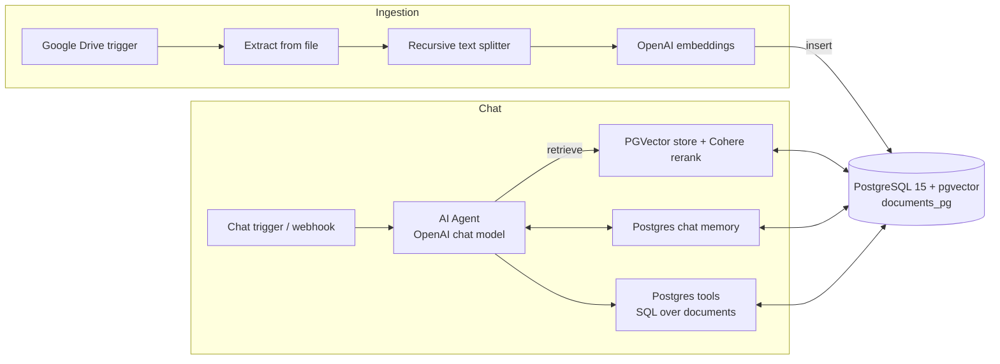
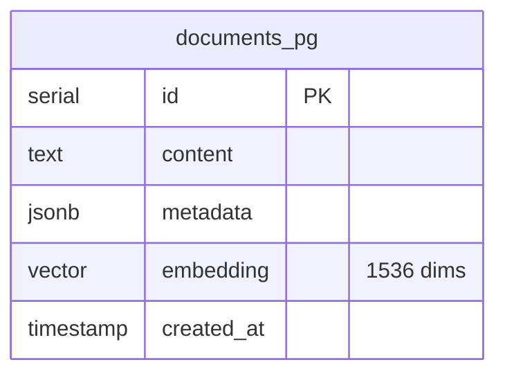

# postgres — pgvector store for n8n RAG agents

A ready-to-run **PostgreSQL + pgvector** setup that serves as the vector store for an n8n RAG (retrieval-augmented generation) AI agent. Ships with the database schema, server configuration and an importable n8n workflow template: Google Drive ingestion, chunking and embeddings, an AI agent with Postgres chat memory, vector retrieval with Cohere reranking and SQL tools.

## How it fits together



## Schema



`init.sql` enables the `vector` extension, creates `documents_pg` and an index for similarity search.

## What's inside

```
docker-compose.yml   — pgvector/pgvector:pg15 container
init.sql             — extension, table and index
postgresql.conf      — server tuning
pg_hba.conf          — access rules
n8ntemplate.json     — "RAG AI Agent" n8n workflow
.env.example         — connection settings
```

## Run

```bash
cp .env.example .env
docker compose up -d
```

PostgreSQL listens on port **5433**. In n8n, add a Postgres credential pointing at this database, import `n8ntemplate.json` (Workflows → Import from file) and set your OpenAI credential.

> Before exposing the database outside your machine, set a strong password and review `pg_hba.conf` (the default compose file uses `trust` auth for convenience).

Related: [n8n](https://github.com/Fortuneq/n8n) — self-hosted n8n setup.
